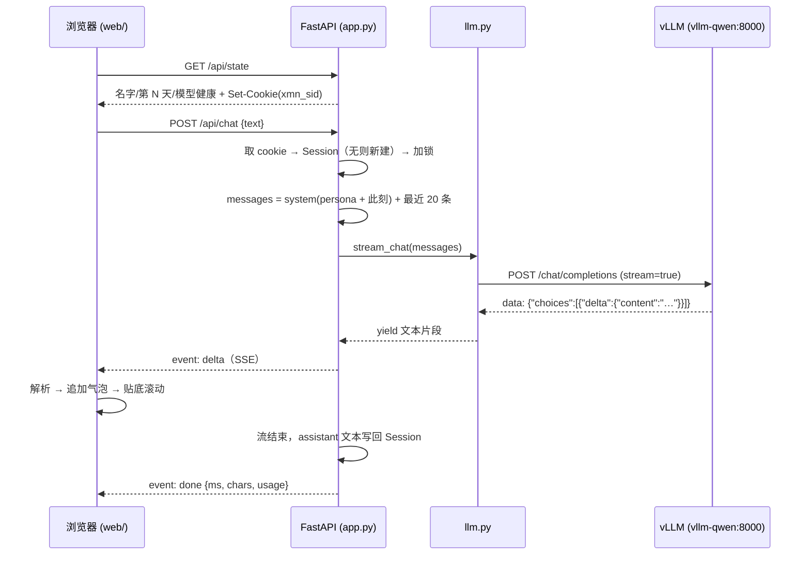

# 架构与数据流

> 这份文档跟着代码走：**每次改代码，同一个 commit 里更新它**。
> 现在覆盖第 1 步（单页 + 本地模型 + 人格），没有数据库、没有跨会话记忆。

## 1. 技术栈

| 层 | 用了什么 | 为什么 |
|---|---|---|
| 后端 | Python 3.12 + FastAPI + uvicorn | 一个文件就能起服务，SSE 直出 |
| 模型调用 | httpx 直连 OpenAI 兼容接口 | 不引 SDK，流式解析可控 |
| 前端 | 原生 HTML/CSS/JS（ES module） | 零构建，改完刷新 |
| 存储 | 无（会话在进程内存） | 第 1 步故意不引数据库 |
| 评测 | 标准库 + httpx 脚本 | 可重复、可进 git |

## 2. 目录职责

| 路径 | 职责 | 不该做什么 |
|---|---|---|
| [web/index.html](../web/index.html) | 三个区域：头部（宠物/状态）、消息流、输入框 | 不写业务逻辑 |
| [web/app.js](../web/app.js) | SSE 解析、气泡渲染、忙碌态、人格弹窗、新对话 | 不拼 prompt |
| [web/pet.js](../web/pet.js) | 内联 SVG 团子 + 表情切换 | 不碰对话状态 |
| [web/style.css](../web/style.css) | 暗色暖调、手机优先、动画 | — |
| [src/xiaoman/app.py](../src/xiaoman/app.py) | 路由、会话、SSE、人格读取、健康检查 | 不实现模型协议细节 |
| [src/xiaoman/llm.py](../src/xiaoman/llm.py) | 调 vLLM、解析流、超时/重试、错误文案 | 不知道「人格」「会话」 |
| [src/xiaoman/config.py](../src/xiaoman/config.py) | 读 `config.toml` + 环境变量 | 不读业务数据 |
| [src/xiaoman/persona/base.md](../src/xiaoman/persona/base.md) | 人格契约与规则 | 不写实现细节 |
| [src/xiaoman/safety.py](../src/xiaoman/safety.py) | 危机触发词、固定回应、求助信息 | 不调用模型 |
| [scripts/selfplay.py](../scripts/selfplay.py) | 固定剧本跑真实接口、算指标 | 不改产品代码 |

## 3. 一次输入到输出的完整链路



对应到代码，一次对话经过 12 步：

1. 打开 `/` → 返回 [index.html](../web/index.html)（`Cache-Control: no-store`）
2. 页面启动 → `GET /api/state`：中间件建 Session、下发 `xmn_sid` cookie，返回名字、第几天、模型健康
3. 输入 → `form` 提交 → `app.js` 的 `send(text)`，关掉输入框，显示「···」
4. `fetch POST /api/chat`，body `{"text": "..."}`，准备读流
5. 中间件按 cookie 找 Session；没有就新建（内存 dict，最多 200 个）
6. 进 `session.lock`（同一会话串行），把 user 消息追加进 `session.messages`
6.5 **红线检查**：命中危机语句 → 直接用 `safety.build_reply()` 拼固定回应，跳过 7–10，`done` 里带 `safety: true`
7. 组装 `messages`：`[system(persona 文件 + 此刻)] + messages[-max_history:]`
8. [llm.stream_chat](../src/xiaoman/llm.py) 向 vLLM 发 `stream=true`、`stream_options.include_usage`
9. 逐行解析 `data:`，取出 `delta.content` 产出文本；同时记 usage
10. [app.py](../src/xiaoman/app.py) 包成 SSE：`meta` → 若干 `delta` → `done`；出错发 `error`
11. 浏览器 `ReadableStream` 解码（处理多字节边界）→ 按空行切事件 → 追加到气泡
12. 流结束：有内容就把 assistant 消息写回 Session；无内容且失败则撤回刚追加的 user 消息，避免重试时重复

## 4. 状态放在哪

| 状态 | 位置 | 生命周期 |
|---|---|---|
| 会话消息 | `app.py` 里的 `_sessions` 字典 | 进程内；重启即消失；6 小时 TTL |
| 会话身份 | `xmn_sid` cookie（HttpOnly） | 6 小时 |
| 人格 | `persona/base.md` + mtime 缓存 | 文件改了下次请求即生效 |
| 配置 | `config.toml` + `config.local.toml`（私密覆盖）+ `XIAOMAN_*` 环境变量 | 改完重启 |
| 安全资源 | `config.local.toml` 的 `[safety]` | 改完重启；不进公开仓库 |
| 模型连接 | 每次请求新建 `httpx.AsyncClient` | 请求级 |

## 5. 错误与取消

| 情况 | 行为 |
|---|---|
| 连不上模型 | 重试 1 次（未出字前）→ SSE `error`，文案让人去查 vLLM |
| 超时（默认 60s） | SSE `error`，已生成的部分保留 |
| 非 200 | 带状态码和前 160 字响应体 |
| 用户点「停」 | 客户端 abort → 服务端生成器取消，已生成部分写回 |
| 模型挂了但页面已开 | 头部红点；聊天仍可打开，报错可见 |
| 空消息 | 400，不建会话消息 |
| 命中危机语句 | 不调模型，固定回应；日志只记 `safety_trigger`，不记内容 |

## 6. 前端结构

- `.log` 是 `role="log"` + `aria-live="polite"`，读屏会播报新消息
- 气泡内容一律用 `textContent`，**不注入 HTML**（模型输出不可信）
- `busy` 时发送键变「■」并 `abort()`；`Enter` 发送、`Shift+Enter` 换行
- 人格弹窗直接 `GET /api/persona` 显示原文，方便对照着改
- 动画都包在 `prefers-reduced-motion` 里

## 7. 评测链路

```
eval/scenarios.json  →  scripts/selfplay.py  →  POST /api/chat（每剧本一个独立会话）
                                              ↓
                          eval/runs/<版本>/transcript.json（完整对话，git 忽略）
                          eval/results/<版本>/summary.json（汇总，进 git）
```

指标定义见 [WORKFLOW.md](../WORKFLOW.md)。

## 8. 改动指南

| 想改 | 改哪里 | 注意 |
|---|---|---|
| 人格/语气 | `persona/base.md` | 热加载；改完跑 `selfplay.py` 两遍 |
| 模型/端口/名字 | `config.toml` | 重启服务 |
| 新接口 | `app.py` | 同步本文档第 3 节 |
| 安全话术/联系人 | `config.local.toml` 的 `[safety]` | 改完重启；`tests/test_safety.py` 必须过 |
| 页面/交互 | `web/*` | 改完刷新；没有浏览器自动化，需人工看 |
| 评测剧本 | `eval/scenarios.json` | 剧本一旦用于对比就不要改，另开文件 |

**每次改动必须同一个 commit 更新本文档和 `docs/iterations.md`。**

## 9. 已知边界

- 单进程内存会话：多 worker 部署会串会话
- 无鉴权，只绑 `127.0.0.1`；上手机要先加 token
- 不给模型工具调用：流程将来由服务端状态机编排
- 危机协议是固定模板，不做语义判断；联系人只在你本机配置里
